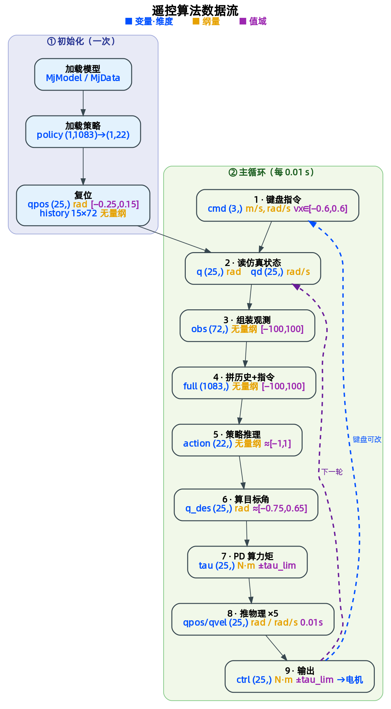

# T800 MuJoCo 遥控行走

用 MuJoCo 仿真 T800 人形机器人，加载 MNN 行走策略，键盘遥控前进/后退/转向。

**当前版本：[v0.0.0](CHANGELOG.md)**（键盘控制行走）


## 目录结构

```
source/
  main.py          # 入口：键盘 + viewer + 软启动循环
  walker.py        # Walker 编排 + 仿真工具（模型加载/PD/观测构建）
  policy.py        # MnnPolicy（MNN 加载与推理）
  camera.py        # 头部 RGB 相机（离屏渲染）
  camera_view.py   # OpenCV 实时相机窗口（独立脚本，读 qpos 共享文件）
  config.py        # 读 YAML → numpy 配置对象
config/
  t800.yaml        # 全部可调参数（关节/PD/观测缩放/时序/按键/出生点）
model/             # MNN 行走策略（22 关节）
mujoco/
  t800.xml         # 顶层模型：robot + 平地
  robot/           # T800 MJCF + mesh + 贴图
  scene/           # 场景（ground/ 平地、warehouse/ hero_layout 仓库）
doc/               # 文档配图
```

## 环境

- conda 环境：`t800`
- 依赖：`mujoco`、`numpy`、`MNN`、`PyYAML`

```bash
conda activate t800
pip install -r requirements.txt   # 若环境已就绪可跳过
```

## 运行

```bash
conda activate t800
python source/main.py                # 打开 viewer 遥控
python source/main.py --config path/to/other.yaml   # 换配置
```

## 按键

| 键 | 作用 | command 分量 |
|---|---|---|
| ↑ | 前进 | `vx` +cmd_step |
| ↓ | 后退 | `vx` −cmd_step |
| ← | 左转 | `yaw` +cmd_step |
| → | 右转 | `yaw` −cmd_step |
| 空格 | 停止 | 全部归零 |

步长与限幅在 `config/t800.yaml` 的 `teleop` 段。

## 头部相机

`mujoco/robot/t800/xml/serial_links.xml` 的 `LINK_HEAD_YAW` 上挂了一个名为 `head` 的 RGB 相机
（朝机体 +x、图像上方 +z、`fovy=60`，站立时约 1.67 m 高）。

- **viewer 第一视角**：运行 `source/main.py` 后，在左侧 Rendering 面板把 Camera 选到 `head`。
- **OpenCV 实时窗口**（两个独立启动脚本）：

  ```bash
  # 终端 1：仿真（qpos 自动写到 /tmp/t800_qpos.bin）
  python source/main.py
  # 终端 2：读取 qpos，用 OpenCV 显示 head 相机
  python source/camera_view.py
  ```

  相机脚本与 viewer 分属两个进程，避免 OpenGL 上下文冲突；按 `Esc`/`q` 或关闭窗口即可退出相机窗口。
  若方向键没有反应，先点一下 viewer 窗口让它获得键盘焦点。
- **代码取图**：

  ```python
  from camera import HeadCamera

  with HeadCamera(w.model) as cam:
      rgb = cam.render(w.data)   # (480, 640, 3) uint8
  ```

## 算法数据流



每 `control_dt`（0.01 s）一轮：`观测(72,) → 15 帧历史 → full(1083,) → 策略 → action(22,) → 目标角 → PD → mj_step×5`

## 参数配置

改 `config/t800.yaml` 即可调参，无需改代码：
- `control`：站姿 `default_q`、PD `kp/kd`、动作缩放 `action_scale`
- `observation`：各观测分量缩放与截断、历史帧数
- `teleop`：按键步长、限幅、软启动
- `timing`：控制/仿真周期
- `reset`：出生点 `base_pos`（x,y）与高度 `base_z`

## 场景

当前为 hero_layout 仓库 `mujoco/scene/warehouse/warehouse.xml`
（来自 [VLA_mujoco_multi_unitree_warehouse](https://github.com/KiwooShin/VLA_mujoco_multi_unitree_warehouse)：
16×12 m 大厅、两排货架、NE 隔断、东侧交货垫、南墙 4 个 home bay、8 个物体）。

自己切换场景（两个场景都定义 `geom name="floor"`，include 只能二选一，同开会加载失败）：

1. **换 include**：编辑 `mujoco/t800.xml`，放开要生效的场景 include、注释掉另一个。
2. **改出生点**：编辑 `config/t800.yaml` 的 `reset.base_pos`（config 只在启动时读一次，改完必须重启）。
3. **重启**：`conda activate t800 && python source/main.py`。

| 场景 | include | `reset.base_pos` |
|---|---|---|
| 仓库（当前） | `scene/warehouse/warehouse.xml` | 任选：Alpha `[-5,-5]`、Bravo `[-2,-5]`、Charlie `[2,-5]`、Delta `[5,-5]` |
| 平地 | `scene/ground/ground.xml` | `[0, 0]` |

注：`reset` 无朝向字段，出生朝向固定为 +x；仓库 bay 沿南墙，朝 +x 即沿墙开阔通道。

## 资产来源

- 机器人 MJCF / mesh 来自 [engineai-robotics/engineai_robotics_native_sdk](https://github.com/engineai-robotics/engineai_robotics_native_sdk)（仅保留 T800 所需子集）。

## 更新日志

见 [CHANGELOG.md](CHANGELOG.md)。当前版本 `v0.0.0`：键盘控制行走。


## 参考
https://github.com/KiwooShin/VLA_mujoco_multi_unitree_warehouse