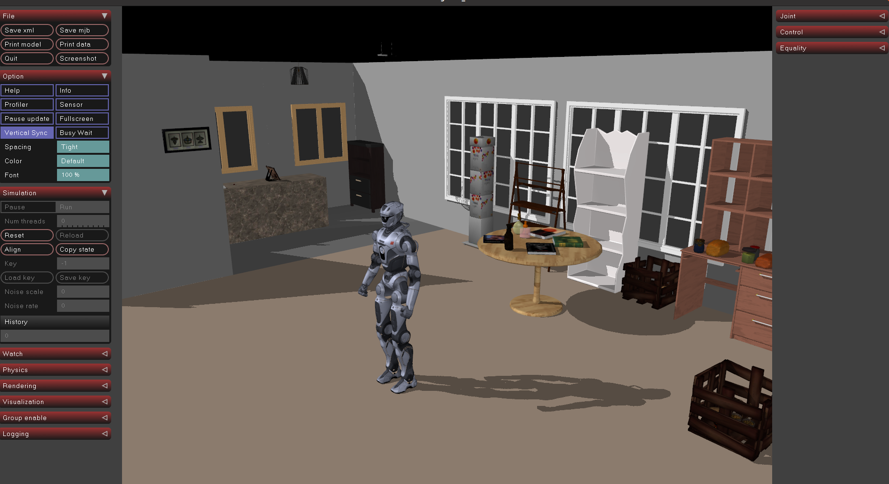

# T800 MuJoCo 遥控行走

用 MuJoCo 仿真 T800 人形机器人，加载 MNN 行走策略，键盘遥控前进/后退/转向。

**当前版本：[v0.0.0](CHANGELOG.md)**（键盘控制行走）



## 目录结构

```
source/
  main.py          # 入口：键盘 + viewer + 软启动循环
  walker.py        # Walker 编排 + 仿真工具（模型加载/PD/观测构建）
  policy.py        # MnnPolicy（MNN 加载与推理）
  config.py        # 读 YAML → numpy 配置对象
config/
  t800.yaml        # 全部可调参数（关节/PD/观测缩放/时序/按键/出生点）
model/             # MNN 行走策略（22 关节）
mujoco/
  t800.xml         # 顶层模型：robot + 平地
  robot/           # T800 MJCF + mesh + 贴图
  environment/     # 平地 ground.xml
doc/               # 文档配图
```

## 环境

- conda 环境：`t800`
- 依赖：`mujoco`、`numpy`、`MNN`、`PyYAML`

```bash
conda activate t800
pip install -r requirements.txt   # 若环境已就绪可跳过
```

## 运行

```bash
conda activate t800
python source/main.py                # 打开 viewer 遥控
python source/main.py --config path/to/other.yaml   # 换配置
```

## 按键

| 键 | 作用 | command 分量 |
|---|---|---|
| ↑ | 前进 | `vx` +cmd_step |
| ↓ | 后退 | `vx` −cmd_step |
| ← | 左转 | `yaw` +cmd_step |
| → | 右转 | `yaw` −cmd_step |
| 空格 | 停止 | 全部归零 |

步长与限幅在 `config/t800.yaml` 的 `teleop` 段。

## 算法数据流


每 `control_dt`（0.01 s）一轮：`观测(72,) → 15 帧历史 → full(1083,) → 策略 → action(22,) → 目标角 → PD → mj_step×5`

## 参数配置

改 `config/t800.yaml` 即可调参，无需改代码：
- `control`：站姿 `default_q`、PD `kp/kd`、动作缩放 `action_scale`
- `observation`：各观测分量缩放与截断、历史帧数
- `teleop`：按键步长、限幅、软启动
- `timing`：控制/仿真周期
- `reset`：出生点 `base_pos`（x,y）与高度 `base_z`

## 场景

当前为平地 `mujoco/environment/ground.xml`。如需换成房间场景：
在 `mujoco/t800.xml` 里把平地 include 换成场景 include，并把 `reset.base_pos` 改为场景出生点。
注意场景自带 `geom name="floor"` 时不要再 include `ground.xml`（重名会加载失败）。

## 资产来源

- 机器人 MJCF / mesh 来自 [engineai-robotics/engineai_robotics_native_sdk](https://github.com/engineai-robotics/engineai_robotics_native_sdk)（仅保留 T800 所需子集）。

## 更新日志

见 [CHANGELOG.md](CHANGELOG.md)。当前版本 `v0.0.0`：键盘控制行走。
